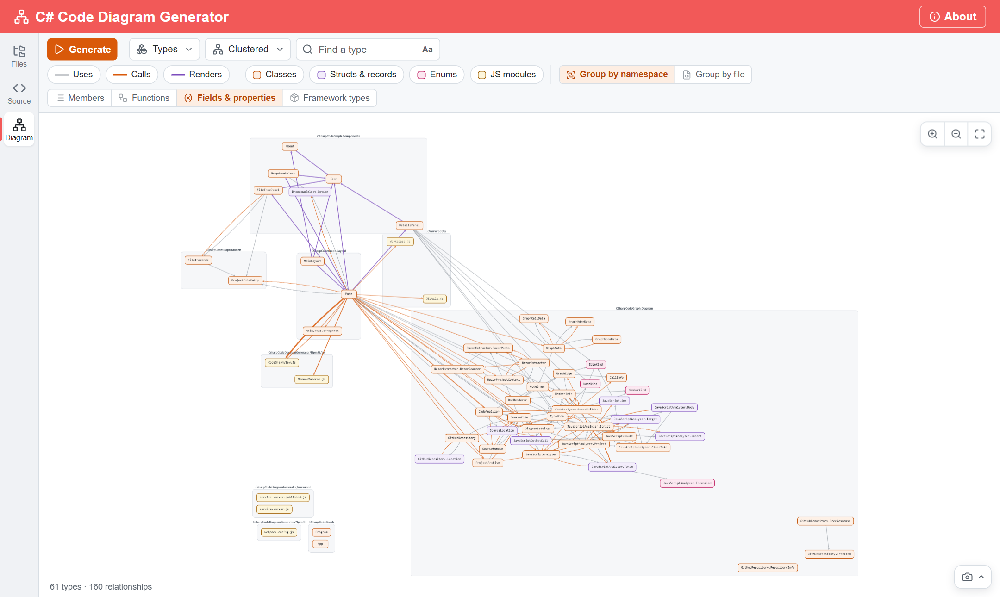
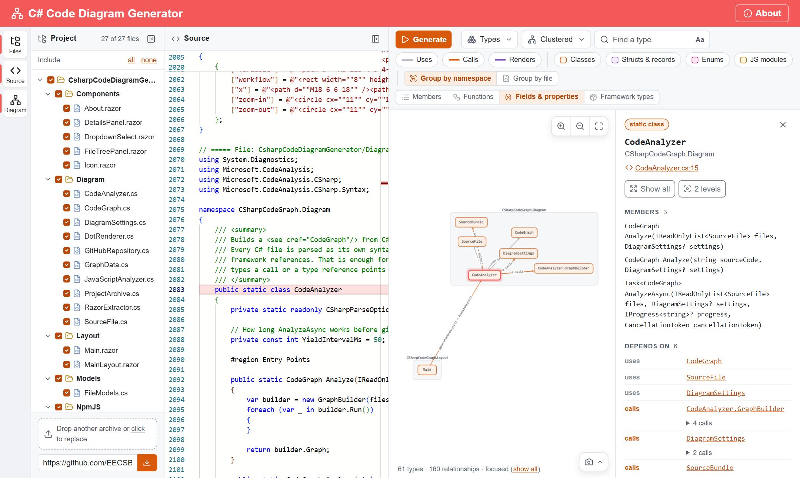

# C# Code Diagram Generator




<br>
<br>

## About
I wanted to get a diagram of some C# code I was working on. Visual Studio offers this as a feature called Code Map, but it's only available for the enterprise edition. 
So I quickly cobbled together this project by reusing some code from other projects I made and "vibe coded" the rest with AI(so I don't guarantee code quality or that it's without bugs).

<br>

## Try it out
You can try it out [here](https://eecs.blog/BlazorApps/CsharpCodeDiagramGenerator/)

<br>

## What it does
Paste C# code into the editor, drop an archive of a project on the Project panel (`.zip`, `.7z`, `.rar` or `.tar`, also `.tar.gz`, `.tar.bz2` and `.tar.xz`), or paste the address of a public GitHub repository or one of its folders. Only the `.cs`, `.razor` and JavaScript (`.js`, `.mjs`, `.cjs`) files are read (JavaScript libraries and bundles are listed but left out until you tick them). Everything runs in the browser; no code is sent anywhere.

- **Relationships:** inheritance, interface implementations, types a class uses (in properties, fields and method or constructor signatures), method calls and object creation between types, and which Razor components render which.
- **Accurate calls:** calls are resolved with Roslyn's semantic model, so `list.Add()` isn't mistaken for your own `Cart.Add()`. Many calls between two types are drawn as one edge.
- **JavaScript:** each `.js` file is a box with its functions and variables (and the functions of objects like `window.X = { ... }`), each class a box of its own. Imports, calls between files and Blazor's JS interop are relationships too: `IJSRuntime.InvokeVoidAsync("X.f")` in C# and `invokeMethodAsync("Name")` back to a `[JSInvokable]` method.
- **Call tracing:** "Functions" draws each function inside its type's box, with the calls from function to function (also within a type). Clicking a function highlights everything that leads to it and everything it calls, and opens it in the editor; "Focus" then shows just that call chain.
- **Razor components:** `@code` blocks, `@inject`, `@inherits`, `@implements`, `@typeparam` and the markup's event handlers and child components are taken into account, together with the component's code-behind file and the `@inject`, `@inherits` and `@implements` of the `_Imports.razor` files above it.
- **Less at once:** types show just their name (members are optional), the details panel lists a selected type's members (click one to see it in the editor) and relationships, "Focus" shows only a type and its neighbours, and the namespace overview summarizes big projects.
- **Filters and search:** show or hide each kind of relationship and type, find a type (or, with "Functions" on, a function) by name, group the types by namespace or by file (clicking a file in the Project panel then selects its box), and switch between a clustered and a layered layout, or have Graphviz draw the diagram, as the first version did.
- **Export:** PNG image or Graphviz DOT.

<br>

## Building it
You need the .NET 9 SDK and Node.js (npm). `dotnet build` also installs the npm packages and builds the JavaScript bundles (Monaco editor, Cytoscape.js and Viz.js) in `NpmJS`, but only when they changed.

```
dotnet build CSharpCodeGraph.csproj
dotnet run --project CSharpCodeGraph.csproj
```

The diagram code (`Diagram/`) has tests:

```
dotnet test Tests/CSharpCodeGraph.Tests
```

Release builds are compiled ahead of time (AOT) to WebAssembly, which makes the analysis about twice as fast. They need the .NET WebAssembly build tools (`dotnet workload install wasm-tools`, or `wasm-tools-net9` with a .NET 10 SDK), and publishing takes several minutes:

```
dotnet publish CSharpCodeGraph.csproj -c Release
```

<br>
<br>

# Some Examples
These are from the first version, which drew the diagram with Graphviz.


With everything enabled, things could get quite large and messy...


